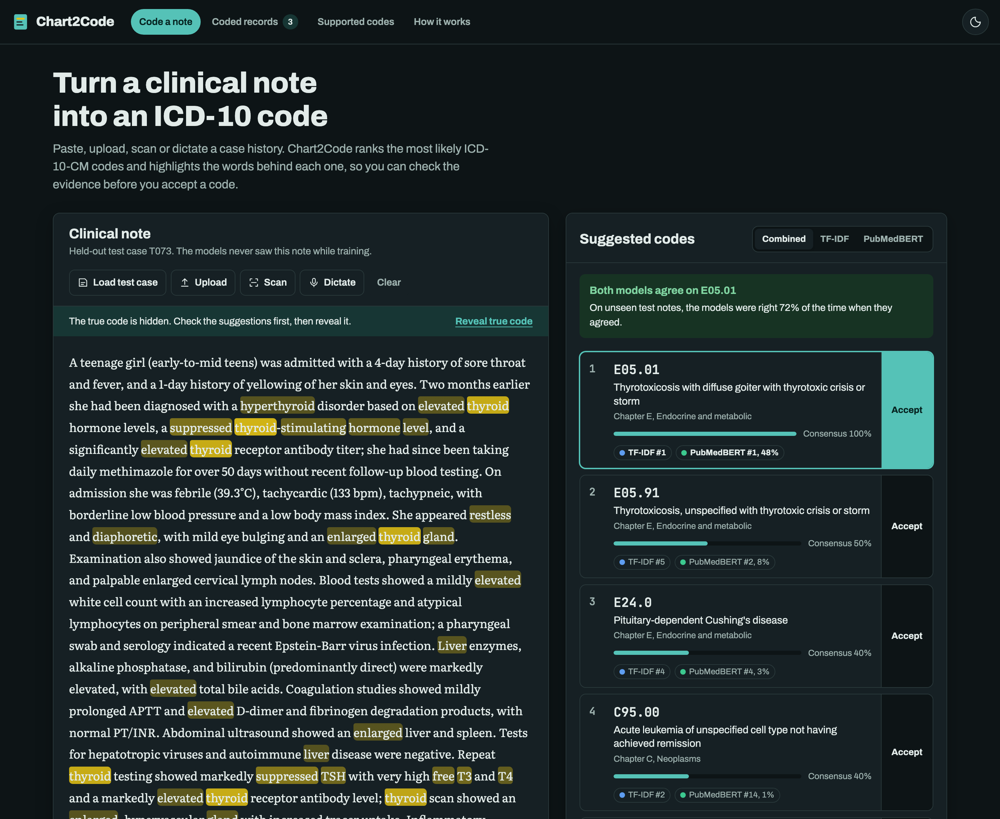

# Automated ICD-10 Code Prediction from Clinical Notes

Machine learning and explainable NLP that suggest an ICD-10-CM diagnosis code for a clinical case history, plus **Chart2Code**, a web app that puts the models in front of a coder.

> Academic project. Not for clinical or billing use.



## What is in this folder

| Path | What it is |
|---|---|
| `ICD10_Code_Prediction_Final.ipynb` | The full project notebook, already run: data analysis, both models, combined model, evaluation, explainability, error analysis, discussion |
| `webapp/` | Chart2Code web app (FastAPI backend + HTML/CSS/JS front end) |
| `webapp/static/demo/` | Demo files for the presentation: `demo_note.txt`, `demo_note.pdf`, `demo_scan.jpg` (a photographed page for the scanner) |
| `figures/` | All charts and app screenshots, ready for slides |
| `final_model_results.csv`, `cross_validation_results.csv`, `fusion_results.csv` | Result tables |

## Results (58 ICD-10 codes, held-out test set of 92 notes)

| Model | Accuracy | Correct code in top 5 | Cross-validated accuracy (15 folds) |
|---|---|---|---|
| Majority-class baseline | 7.6% | 16.3% | - |
| TF-IDF + Logistic Regression | 51.1% | 85.9% | 62.1% ± 5.3 |
| MiniLM embeddings + LR (general) | 44.6% | 81.5% | 45.9% ± 4.6 |
| PubMedBERT embeddings + LR (biomedical) | 60.9% | 90.2% | 56.4% ± 4.6 |
| **Combined (rank fusion)** | **63.0%** | **91.3%** | 61.0% ± 4.0 |

When TF-IDF and PubMedBERT agree they are right 72% of the time; when they disagree, only 50%. The app flags those notes for review.

## Clone and run

### What you need

- [Git](https://git-scm.com/downloads) and **Python 3.12 or 3.13** ([python.org](https://www.python.org/downloads/)). Check with `python3 --version`.
- About 2 GB of free disk space and an internet connection the first time. The setup downloads the Python packages and the PubMedBERT model (about 450 MB) once; after that the app also works offline.

### macOS or Linux

```bash
git clone https://github.com/ATG-AVI/icd10-code-prediction.git
cd icd10-code-prediction/webapp
./run.sh
```

The first run takes a few minutes. It creates a virtual environment in `webapp/.venv` and installs the packages, then starts the app and opens http://127.0.0.1:8000 in your browser. The trained models are already in the repository, so nothing has to be trained. Later runs start in a few seconds with the same `./run.sh`. Press `Ctrl+C` in the terminal to stop the app.

### Windows (PowerShell)

```powershell
git clone https://github.com/ATG-AVI/icd10-code-prediction.git
cd icd10-code-prediction\webapp
py -3.12 -m venv .venv
.venv\Scripts\pip install -r requirements.txt
.venv\Scripts\python app.py
```

Then open http://127.0.0.1:8000. Next time, only the last command is needed (run it from the `webapp` folder).

### The notebook

- **In Google Colab, no install:** [open the notebook in Colab](https://colab.research.google.com/github/ATG-AVI/icd10-code-prediction/blob/main/ICD10_Code_Prediction_Final.ipynb), then choose Runtime → Run all (about 5-10 minutes on CPU).
- **Locally:** open `ICD10_Code_Prediction_Final.ipynb` in Jupyter or VS Code. Its first cell installs what it needs.

### If something goes wrong

- **"Python 3.12 or newer is required":** install Python 3.12 or 3.13, then run `./run.sh` again.
- **Port 8000 already in use:** another app is using that port. Stop it, or change `port=8000` at the bottom of `webapp/app.py`.
- **Retrain the models** (optional, about 1 minute): delete `webapp/model/models.joblib` and run `./run.sh`, or run `.venv/bin/python train.py` inside `webapp`.

## Demo script for the presentation (about 5 minutes)

1. **Start the app** with `./run.sh`. It opens on a random held-out test case the models never saw.
2. **Explain the screen.** Ranked codes on the right, each showing where TF-IDF and PubMedBERT ranked it. The yellow highlighter marks are the words that support the selected code; pink marks point away from it. Click another suggestion and the highlights change.
3. **Reveal true code** to show whether the model was right. Click **Load test case** for another one; it is random, so some will be wrong, and that leads into the error analysis.
4. **Scan.** Click **Scan**, then **Try a sample page** (or **Start camera** and hold up a printed page). The page is read with OCR in the browser, then **Use this text**. It should suggest `I33.0` infective endocarditis, with mitral regurgitation, murmur and blood culture highlighted.
5. **Upload** `webapp/static/demo/demo_note.pdf` (ectopic pregnancy) or drag it onto the note.
6. **Dictate** (Chrome or Edge): speak a short case, e.g. *"Young woman with palpitations, weight loss, heat intolerance, tremor, enlarged thyroid, suppressed TSH and high free T4."*
7. **Accept** a code, or assign another one in the search box, then open **Coded records** to show the saved decisions, the review flags and **Export CSV**.
8. **Supported codes** shows the 58 codes and the words each one learned. **How it works** shows the measured accuracy and charts.

Tip: `http://127.0.0.1:8000/?case=T073` always opens the same test case (thyroid storm, both models correct).

## How it works

1. **Data:** 1,798 de-identified case histories from open-access PubMed Central case reports ([mkurman/clinical-case-icd10-diagnosis](https://huggingface.co/datasets/mkurman/clinical-case-icd10-diagnosis)), one ICD-10-CM code each, diagnosis removed from the text. 675 of 995 codes appear once, so we keep the 58 codes with at least 5 cases.
2. **Split:** 80/20 grouped by source publication, so no article appears in both train and test.
3. **Model 1:** TF-IDF (words and word pairs) + Logistic Regression, tuned with grouped cross-validation on training data only.
4. **Model 2:** frozen sentence encoders (MiniLM, PubMedBERT) + Logistic Regression. MiniLM cuts off 94.6% of notes at 256 tokens; PubMedBERT reads them in full.
5. **Combined:** reciprocal rank fusion of TF-IDF and PubMedBERT.
6. **Explainability:** TF-IDF word weights (the highlights), top-k probabilities, and nearest training cases.

## Data and licences

The case histories come from the Hugging Face dataset above, which is derived from open-access PubMed Central articles under per-article licences (mostly CC BY, some CC BY-NC / CC BY-ND, a few publisher-copyright). `webapp/model/app_data.json` contains the de-identified case texts used by the app. Check the dataset card and each row's licence before reusing them outside academic study.

## Limitations

- 58 of roughly 70,000 ICD-10-CM codes; small test sets (about ±5 points of uncertainty).
- Codes in the dataset were assigned by an LLM and validated as billable, not audited by certified coders.
- Published case reports are cleaner and more unusual than routine hospital notes; one code per note.
